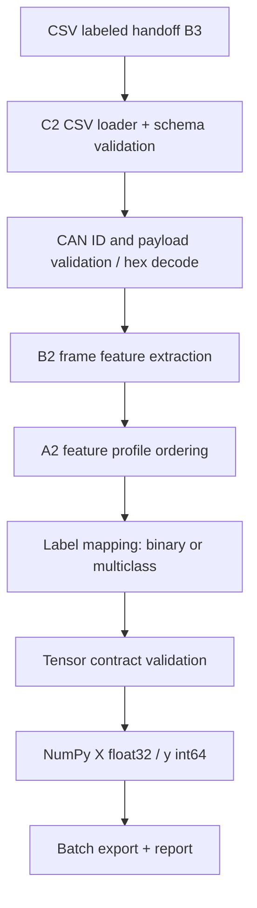

# C2 Week 2 Integration Report — v0.3.0

## Task

Integrate the C2 Week 1 loader with B3's labeled sample, B2 feature extractor, and A2 handover v1.2; export tensor/batch in the A2 input shape/dtype contract.

## Architecture (integration path)



## Source inputs

- C2 Week 1 ZIP: loader/CLI and original B2 sample.
- B2 Week 2 branch ZIP: `feature_extraction.py`, `segment_utils.py`, feature extraction/preprocessing specs.
- B3 handoff ZIP: labeled sample, manifest, label/data specification.
- A2 handover v1.2 ZIP: feature order, tensor contract, Schema 1.0.0 integration spec, technical decisions.

## Implemented and verified

| Item | Result |
|---|---|
| CSV / schema loading | PASS, 18 rows, required columns present |
| CAN ID parse | Hex decoded (e.g. `0130` → 304 decimal), supports up to 29-bit ID |
| Payload | Explicit hexadecimal conversion, including `ff` → 255 |
| DLC | Validated integer in `[0,8]` |
| Missing byte inside DLC | Rejects (A2 v1.2 default) |
| Non-zero payload beyond DLC | Rejects |
| Default feature profile | A2 proposed `hcrl_frame_18`, ordered `can_id_int, dlc, data_0..7, payload_mask_0..7` |
| Binary target | `label` 0=Normal, 1=Attack |
| Multiclass target | `attack_type`: normal=0, dos=1, fuzzy=2, gear=3, rpm=4 |
| Default X dtype/shape | `float32`, `(18,18)` |
| Default y dtype/shape | `int64`, `(18,)` |
| Multiclass tensor | PASS, X `(18,18)` float32, y `(18,)` int64 |
| Baseline-A smoke test | PASS, `b2_baseline_a_23`, 23 features, X `(18,23)` |
| Baseline-B smoke test | PASS, `b2_baseline_b_22`, 22 features, X `(18,22)` |
| Batch size 8 | PASS, all configurations produce 3 batches (8, 8, 2) |
| Tensor finite validation | PASS, all 4 configurations contain finite values |
| CSV column shuffle | PASS; canonical feature order retained |
| Leakage check | PASS; labels, timestamps, and metadata excluded from X |
| Manifest integrity | VERIFIED, SHA-256 matches after CRLF normalization |
| Automated tests | **9 passed** |

## Test commands

Run the following commands from the project root directory:

```powershell
python -m pytest -q

python src/c2_week2.py --input data/b3_handoff/labeled_sample.csv --manifest data/b3_handoff/manifest.json --batch-size 8 --output-dir output/week2/default

python src/c2_week2.py --input data/b3_handoff/labeled_sample.csv --batch-size 8 --profile hcrl_frame_18 --label-mode multiclass --output-dir output/week2/multiclass

python src/c2_week2.py --input data/b3_handoff/labeled_sample.csv --manifest data/b3_handoff/manifest.json --batch-size 8 --profile b2_baseline_a_23 --output-dir output/week2/temporal_smoke

python src/c2_week2.py --input data/b3_handoff/labeled_sample.csv --manifest data/b3_handoff/manifest.json --batch-size 8 --profile b2_baseline_b_22 --output-dir output/week2/baseline_b
```

## Evidence included

- `output/week2_test_results.txt`: pytest summary, 9 passed.
- `output/week2/evidence/pytest.txt`: pytest evidence.
- `output/week2/evidence/default_run_console.json.txt`: default pipeline console report.
- `output/week2/evidence/multiclass_run_console.json.txt`: multiclass pipeline console report.
- `output/week2/evidence/temporal_smoke_console.json.txt`: Baseline-A temporal profile smoke-test console report.
- `output/week2/evidence/baseline_b_run_console.json.txt`: Baseline-B console report.
- `output/week2/default/report.json`: default profile report.
- `output/week2/multiclass/report.json`: multiclass profile report.
- `output/week2/temporal_smoke/report.json`: Baseline-A report.
- `output/week2/baseline_b/report.json`: Baseline-B report.
- `output/week2/temporal_smoke/`: Baseline-A tensors and batches.
- `output/week2/baseline_b/`: Baseline-B tensors and batches.
- `output/week2/run/`: separately verified integration output, including X/y tensors and batches.

## Integrity verification

The raw SHA-256 of the local CSV with LF line endings differs from the manifest because of line-ending differences.

C2 canonicalizes line endings to CRLF before calculating SHA-256. After normalization:

- Raw LF SHA-256: `647f5d3ccc98339eb2b03c713955efc29e090a95fd1a8762e6062f1d3fca8914`
- Expected SHA-256: `42232f553ec5012e1de7b956b38a4825906991e3566955be52f2a5b7d18c8913`
- Actual normalized SHA-256: `42232f553ec5012e1de7b956b38a4825906991e3566955be52f2a5b7d18c8913`

Manifest integrity: **VERIFIED**

`manifest_integrity.matches: true`

The CSV and manifest pair is verified under the current C2 CRLF normalization rule. The line-ending convention should still be documented and agreed upon by C2 and B3.

## Decisions / blockers

- `hcrl_frame_18` is proposed, not final approved.
- Binary vs multiclass remains pending; both implemented, Binary is default to match B3 `label` column.
- Baseline-A/B temporal features and window choices are pending DEC-007/009. Only smoke-tested against this stratified fixture.
- No train/val/test split, purge gap, shared-tail exclusion, imputer/scaler, or FL partitioning implemented. These are waiting on the approved B2/A3 specification; avoid claiming training-ready preprocessing.
- Reviewer confirmation / Git commit or PR still required for handoff.

## Reproducibility

- Tested Python runtime: 3.15.2.
- Install dependencies using `requirements.txt`.
- Run the commands listed in Test commands.
- The B3 18-row stratified fixture is for integration smoke testing only; do not use it to train or evaluate a model.